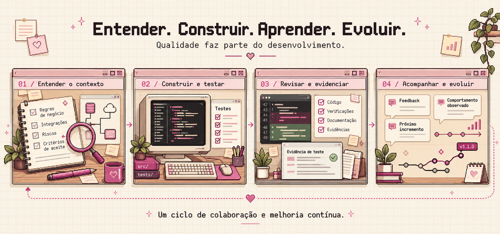

# Workflow de Trabalho e Aprendizados

Os projetos foram criados para utilização minha inicialmente com certas necessidades do meu dia a dia.
Exemplo dos projetos [ladydebug-bot-planner](https://github.com/kellen-xavier/ladydebug-bot-planner) e o [ladydebug-wiki-projects](https://github.com/kellen-xavier/ladydebug-wiki-projects) foram de necessidades que encontrei no meu trabalho, e acabei criando para praticar programação com linguagens que eu gostaria de estudar, e compartilhar ideias que auxilie em algum projeto. Algo como "estrutura base"

## Como é o fluxo do desenvolvimento?

Tudo começa na comcepção, desenhar fluxogramas, escrever as funcionalidades, e qual o objetivo. Após isto
abro o projeto, desenho o flow, crio a documentação simples objetiva, inicialmente para compor o conjunto. Sigo e programo as funcionalidades, mas primeiro a partir de um teste. Executo o teste, corrijo, e após passar o teste, então implemento no código fonte. O ciclo se repite, atualizo a documentação técnica com os resultados de cada teste que foi criado.
O que deu errado ou demorou precisa alterar o processo da próxima rodada, seguindo ["Kaisen" na prática](https://www.lean.org/lexicon-terms/pdca/). O costume de entender a funcionalidade, grau de criticidade e tempo de desenvolvimento, vem sempre depois dos testes aplicados.

## Meu Definition of Done de Estudos

ESTUDO CONCLUÍDO

- [ ] entendi o conceito
- [ ] consegui explicar com minhas palavras
- [ ] apliquei em um projeto leia o [blog](https://kellen-xavier.github.io/ladydebug.github.io/)
- [ ] existe código/teste/documento verificável
- [ ] rodei as verificações do projeto
- [ ] registrei o que aprendi

> o repositório deve guardar evidência do aprendizado.

---

## Inicio do Trabalho

Para gerar os projetos que venho atuando ou simplemente trabalhar neles, inicio via terminal o [ai-memory](https://aimemory.sh/pt-br/) com o meu agente, abro na raíz do projeto, faço a analise e vejo quais modificações deve ser realizadas.

Gero uma base de conhecimento caso o projeto não tenha um para compartilhar com a equipe envolvida (docs as code).
Crio uma Wiki nos projetos para o desenvolvimento sempre analiso como esta a base de testes do projeto.
Seguindo para criar esses testes e executar o ciclo, testes > implementa no código fonte > testes > deploy.
